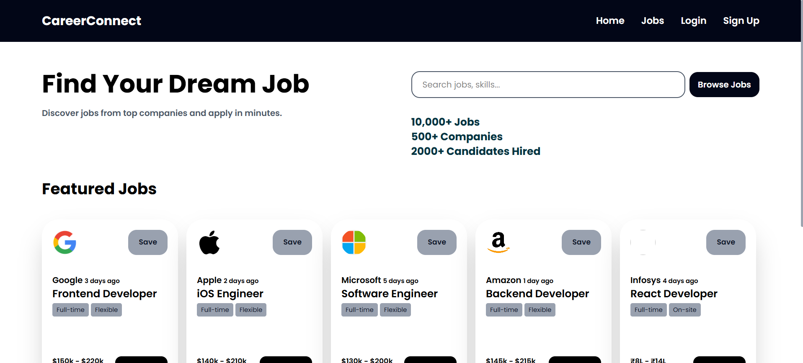
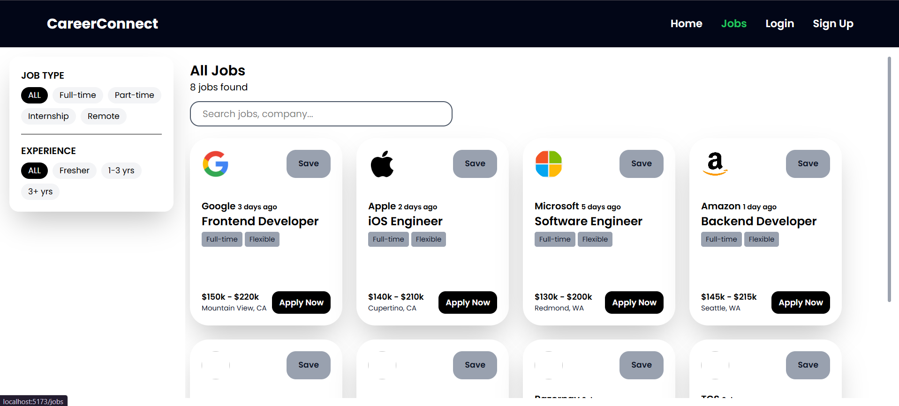
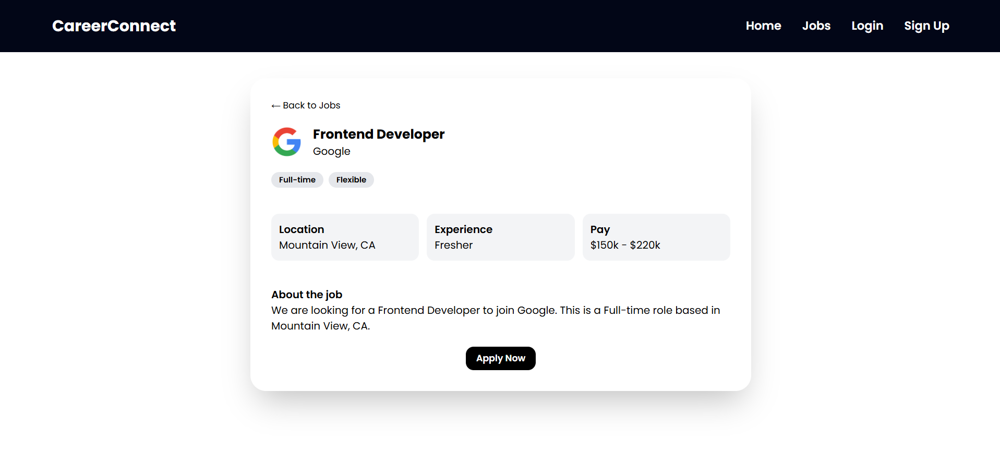
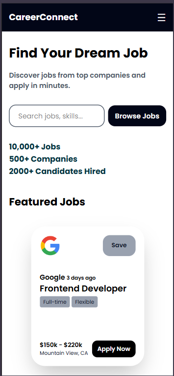

# 💼 CareerConnect

A responsive job portal frontend built with **React**, **Tailwind CSS** and **React Router**. Browse jobs, search and filter them, and open a dedicated details page for each listing.

🔗 **Live Demo:** [career-connect-app-frontend.vercel.app](https://career-connect-app-frontend.vercel.app/)



> **Status:** Frontend is complete and deployed. Job data is currently mocked (`src/data/jobs.js`). A Node/Express + MongoDB backend with JWT authentication is in progress.

## ✨ Features

- **Jobs listing** with reusable job cards (logo, company, role, tags, pay, location)
- **Live search** by job title or company name
- **Combined filters**: Job type and Experience work together with search
- **Empty state** ("No Jobs Found") when nothing matches
- **Job details page** with dynamic routing (`/jobs/:id`) and a "Job not found" fallback
- **Login and Sign Up forms** with controlled inputs and validation (required fields, minimum password length, password match)
- **Fully responsive** layout: hamburger menu on mobile, stacked layout on small screens
- **Sticky navbar** and a scrollable jobs area with a fixed filter sidebar on desktop
- **Logo fallback**: companies without a logo show their first letter in a circle

## 🛠️ Tech Stack

- React 19 (Vite)
- Tailwind CSS v4
- React Router
- JavaScript (ES6+)
- Deployed on Vercel

## 🧠 Concepts Used

- `useState` for search, filters, forms and menu toggle
- Controlled components and form validation
- Array methods: `map`, `filter`, `find`
- Combining conditions with `&&` / `||` for multi-filter logic
- Dynamic routing with `useParams` (URL params are strings, converted with `Number`)
- Reusable components and props (`Card`)
- Conditional rendering (ternary and `&&`)
- Mobile-first responsive design with Tailwind breakpoints
- SPA deployment with a `vercel.json` rewrite so deep links work on refresh

## 🚀 Getting Started

```bash
# Clone the repository
git clone https://github.com/jaspreetsingh06/career-connect.git

# Go to the project folder
cd career-connect

# Install dependencies
npm install

# Start the development server
npm run dev
```

Open the local URL shown in the terminal (usually `http://localhost:5173`).

## 📁 Project Structure

```
career-connect/
├── src/
│   ├── components/
│   │   ├── Card.jsx
│   │   └── Navbar.jsx
│   ├── pages/
│   │   ├── Home.jsx
│   │   ├── Jobs.jsx
│   │   ├── JobDetails.jsx
│   │   ├── Login.jsx
│   │   └── SignUp.jsx
│   ├── data/
│   │   └── jobs.js
│   ├── App.jsx
│   └── main.jsx
├── screenshots/
├── vercel.json
└── package.json
```

## 📸 Screenshots

| Jobs (Desktop) | Job Details | Mobile |
|---|---|---|
|  |  |  |

## 🔮 Roadmap

- [ ] Backend with Node.js, Express and MongoDB (replace mock data with a REST API)
- [ ] Authentication with JWT and bcrypt, plus protected routes
- [ ] Save and Apply to jobs
- [ ] Connect the Home page search to the Jobs page
- [ ] Location filter

## 👤 Author

**Jaspreet Singh**
GitHub: [@jaspreetsingh06](https://github.com/jaspreetsingh06)
